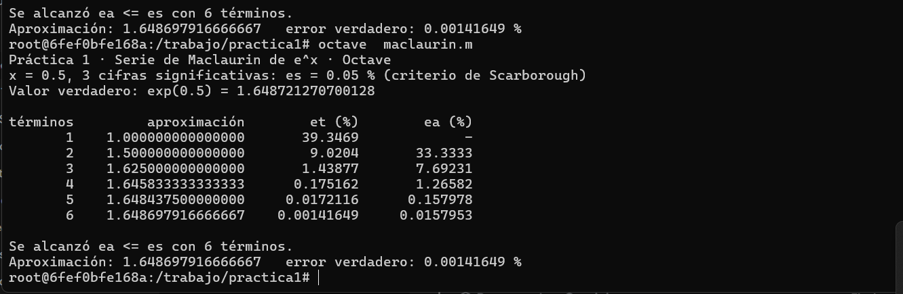
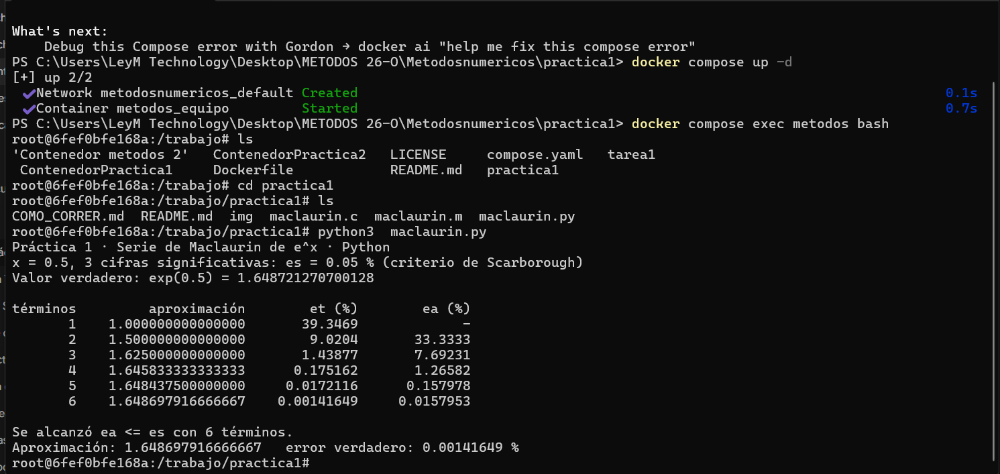
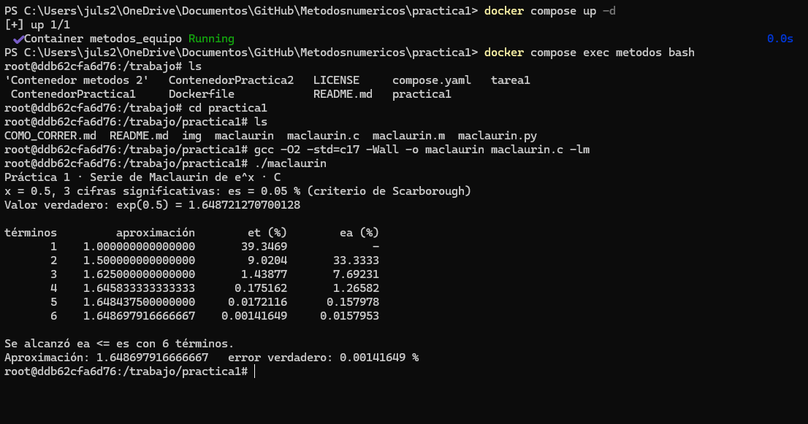

# Práctica 1 · La serie de Maclaurin y el criterio de paro

**UEA 1151039 · Métodos Numéricos en Ingeniería · Trimestre 26-O · UAM Azcapotzalco**
**Profesor:** M. en C. Gabriel Hurtado Avilés

| | |
|---|---|
| Equipo | |
| Integrantes (nombre, matrícula y licenciatura) |*Fuentes Bayona luis Fernando-2243038451-Licenciatura en Ingenieria Mecanica |
| Repositorio de la Tarea 1 de | |
| Fecha | 12/Octubre/2026|

## 1. Octave y Python




¿Coinciden con la lámina 25 de la unidad I?
si coinciden los resultados, en los programas se alcanza una misma  aproximacion y el mismo error relativo que coincide con la lamina 25 de la unidad 1

## 2. Las dos líneas que completamos en `maclaurin.c`

```c
/* COMPLETAR 1 */
termino = termino * X / n;
/* COMPLETAR 2 */
ea = fabs((aprox - anterior) / aprox) * 100.0;
```



## 3. Más cifras significativas

| Cifras | εs (%) | Términos | Aproximación | Error verdadero (%) |
|---|---|---|---|---|
| 3 | 0.05	|6 | 1.648697916666667|	0.00141649 |
| 6 | 	0.00005 (5e-05)| 9| 1.648721265035962|3.43549e-07 |
| 17 | | | | |

1. ¿Cuántos términos hacen falta en cada caso?
2. En cada fila de la tabla, ¿εa es mayor o menor que εt? ¿Por qué conviene detenerse con εa?
3. Con 17 cifras el programa termina. ¿Cuántas cifras del resultado son correctas en realidad?
   Relaciónenlo con 0.1 + 0.2 de la Tarea 1.

## Uso de inteligencia artificial

Ninguno / Cuál y para qué.

## Referencias

