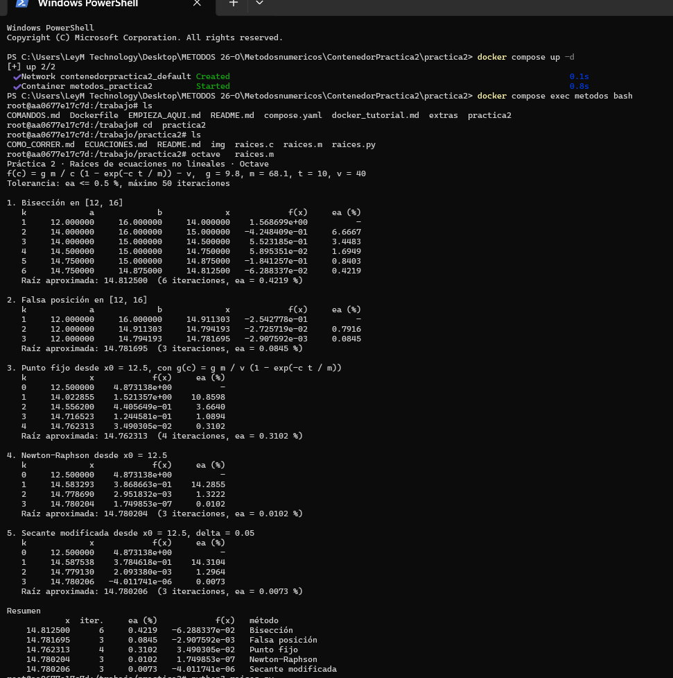
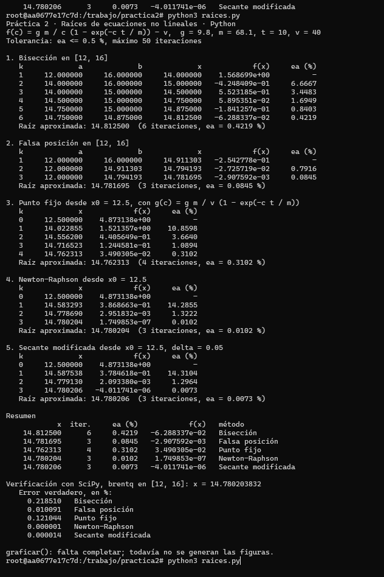
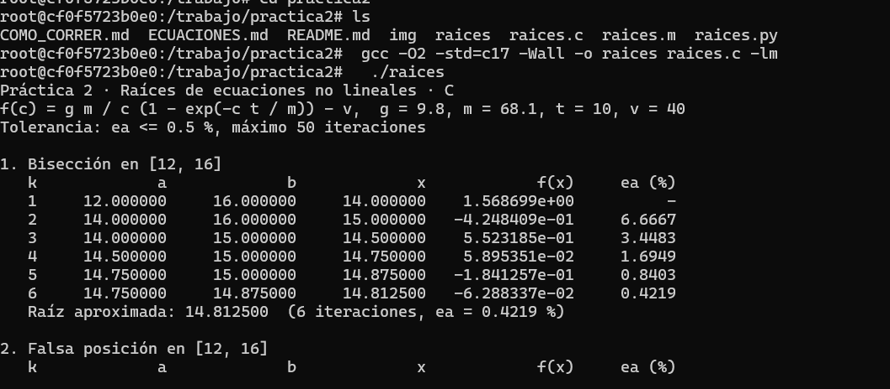
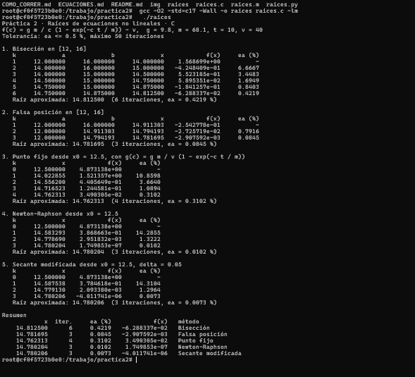
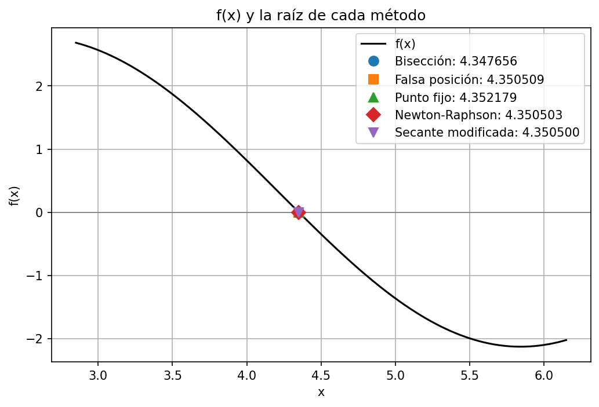
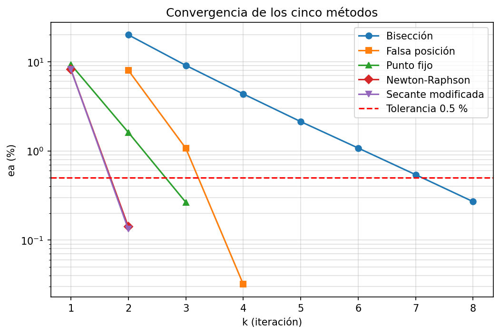
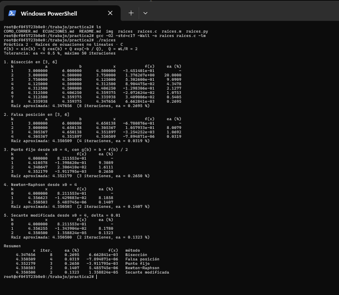
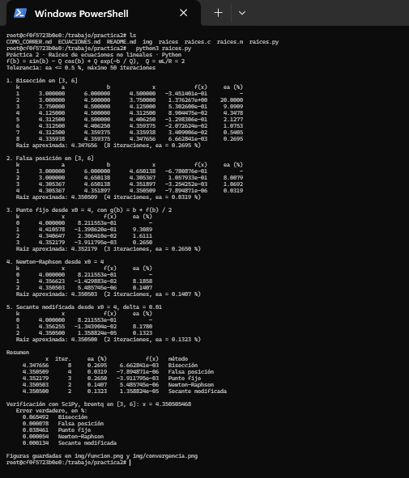

# Práctica 2 · Raíces de ecuaciones no lineales

**UEA 1151039 · Métodos Numéricos en Ingeniería · Trimestre 26-O · UAM Azcapotzalco**
**Profesor:** M. en C. Gabriel Hurtado Avilés

| | |
|---|---|
| Equipo | |
| Integrantes (nombre, matrícula y licenciatura) |*Fuentes Bayona Luis Fernando 2243038451 Ingenieria Mecanica   *Trejo Ponce Julio Antonio 2243038326 Ingenieria Electronica |
| Ecuación asignada | Número y problema |
| Fecha | |

---

## 1. Octave y Python con el paracaidista

Capturas de `octave raices.m` y de `python3 raices.py` sin cambiar nada. Sus tablas
coinciden con las de las láminas de la unidad II.




## 2. Las cinco líneas que completamos en `raices.c`

```c
return fabs((nuevo - anterior) / nuevo) * 100.0;
x = b - (f(b) * (a - b)) / (f(a) - f(b));
x_nuevo = g(x);
x_nuevo = x - f(x) / fp(x);
x_nuevo = x - (delta * f(x)) / (f(x + delta) - f(x));
```




¿Coinciden las tablas de C con las de Octave y Python? Sí / No, y en qué.

## 3. Las gráficas de Python




## 4. Nuestra ecuación

| | |
|---|---|
| f(x) | f(β) = sen β − Q cos β + Q e^(−β/Q), con Q = ωL/R = 2 |
| f'(x) | f'(β) = cos β + Q sen β − e^(−β/Q) |
| g(x) | g(β) = β + f(β)/2 |
| Intervalo [a, b] | [3, 6] |
| x₀ y δ | x₀ = 4 · δ = 0.01 |
| Tolerancia | εa ≤ 0.5 % |




### Tablas (salida de C)

**Bisección**

| k | a | b | x | f(x) | εa (%) |
|---|---|---|---|---|---|
| 1 |12.000000 |16.000000  | 14.000000 | 1.568699e+00 | — |
| 2 | 14.000000  | 16.000000 |  15.000000 |  -4.248409e-01|  6.6667|
| 3 |14.000000 | 15.000000 |  14.500000 |  5.523185e-01 |  3.4483|
| 4 |  14.500000 |  15.000000   |      14.750000 |  5.895351e-02 |   1.6949|
| 5 |   14.750000|  15.000000  |  14.875000   |  -1.841257e-01  |  0.8403 |
| 6 |  14.750000  | 14.875000 |   14.812500  |  -6.288337e-02 |    0.4219 |

**Falsa posición**

| k | a | b | x | f(x) | εa (%) |
|---|---|---|---|---|---|
| 1 |  12.000000 |16.000000 | 14.911303|  -2.542778e-01| — |
| 2 | 12.000000| 14.911303  |  14.794193| -2.725719e-02 |   0.7916|
| 3 |  12.000000|  14.794193|  14.781695|  -2.907592e-03| 0.0845|

**Punto fijo**

| k | x | f(x) | εa (%) |
|---|---|---|---|
| 0 | 12.500000 |  4.873138e+00| — |
| 1 |  14.022855|   1.521357e+00 |  10.8598|
| 2 | 14.556200|  4.405649e-01 |  3.6640 |
| 3 |   14.716523 |   1.244581e-01    | 1.08944
| 4 |   14.762313  |  3.490305e-02   |  0.3102
**Newton-Raphson**

| k | x | f(x) | εa (%) |
|---|---|---|---|
| 0 |  12.500000|4.873138e+00 | — |
| 1 |  14.583293|3.868663e-01  |  14.2855|
 |2   |  14.778690  |  2.951832e-03    | 1.3222|
  | 3|     14.780204 |   1.749853e-07 |    0.0102|
**Secante modificada**

| k | x | f(x) | εa (%) |
|---|---|---|---|
| 0 | 12.500000 | 4.873138e+00| — |
| 1 | 14.587538|  3.784618e-01 | 14.3104 |
| 2 |  14.779130 |   2.093380e-03    | 1.2964|
| 3 |14.780206 |  -4.011741e-06     |0.0073|

Agreguen las filas que hagan falta.

### Resumen

| Método | Raíz | Iteraciones | εa (%) | f(raíz) | Error verdadero (%) |
|---|---|---|---|---|---|
| Bisección | 4.347656 | 8 | 0.2695 | 6.662841e-03 | 0.065492 |
| Falsa posición | 4.350509 | 4 | 0.0319 | -7.894871e-06 | 0.000078 |
| Punto fijo | 4.352179 | 3 | 0.2650 | -3.911795e-03 | 0.038461 |
| Newton-Raphson | 4.350503 | 2 | 0.1407 | 5.485745e-06 | 0.000054 |
| Secante modificada | 4.350500 | 2 | 0.1323 | 1.358824e-05 | 0.000134 |

Raíz de referencia (SciPy): 4.350505468

### Análisis

¿Qué método necesitó menos iteraciones y cuál más? ¿Por qué los cinco no dan
exactamente el mismo número? ¿Alguno no alcanzó la tolerancia o tardó mucho más que
los otros? ¿Por qué?}

Newton-Raphson y la secante modificada necesitaron menos iteraciones (2), y la bisección más (8); el punto fijo y la falsa posición quedaron en medio (3 y 4). Los cinco métodos no dan exactamente el mismo número porque ninguno busca la raíz exacta: cada uno se detiene cuando el cambio entre dos aproximaciones seguidas baja de 0.5 %, y cada uno llega a ese punto por un camino distinto. Todos quedaron a menos de 0.07 % de la raíz de referencia (4.350505468). La secante modificada da casi lo mismo que Newton-Raphson (4.350500 contra 4.350503) porque aproxima la derivada con una diferencia finita (δ = 0.01) en vez de usar la derivada exacta. El εa final de Newton-Raphson (0.1407 %) es mucho mayor que su error verdadero (0.000054 %), porque εa mide cuánto cambió respecto a la iteración anterior, y en un método de convergencia rápida la anterior estaba mucho más lejos de la raíz que la última. Ningún método dejó de alcanzar la tolerancia ni tardó demasiado: el que más tardó fue la bisección, que apenas reduce el intervalo a la mitad en cada paso.

## 5. Cada integrante en su computadora

Cada integrante corre `raices.c` con la ecuación del equipo en su propia computadora y sube
su captura con un commit propio (ver `COMO_CORRER.md`, sección 7).

| Integrante | Usuario de GitHub | Captura |
|---|---|---|
| | | `img/07-integrante-apellido.png` |
| | | |
| | | |


## Uso de inteligencia artificial

Ninguno / Cuál y para qué.

## Referencias
[1] Chapra, S. C., & Canale, R. P. (2015). *Métodos Numéricos para Ingenieros* (7a ed.). McGraw-Hill. Capítulos 5 y 6.
[2] Burden, R. L., & Faires, J. D. (2011). *Análisis Numérico* (9a ed.). Cengage Learning. Capítulo 2.

